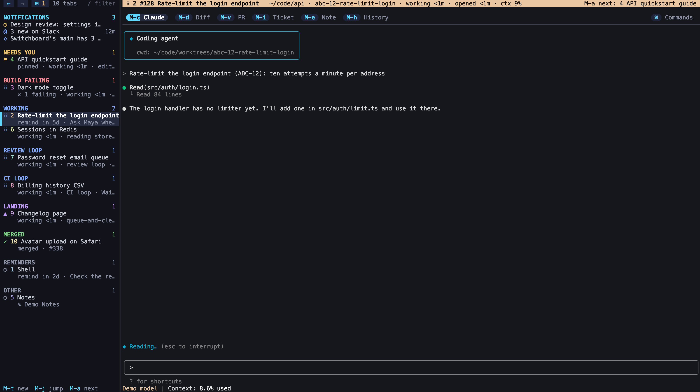
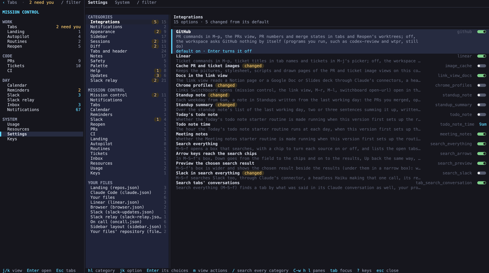

# Switchboard

A terminal workspace for working with coding agents, built around Claude Code. Every tab says what its agent is doing and whether it is waiting on you, one key takes you to the next one that needs you, and a ticket goes from idea to merged PR without leaving the keyboard.

Switchboard is its own terminal multiplexer: a server in the background owns every pane, so closing the terminal never stops an agent, and `switchboard` attaches to it again, as tmux did. The sidebar, mission control, the command palette, the PR and ticket views, a diff viewer that tells a change as a story, a notes app and a Slack relay for when you are away are built in. It is one program, `switchboard`.



It is opinionated: the defaults are how it is meant to be used, and Settings (`M-p`, then Settings) turns off the parts you don't want.

## What's in it

- **The sidebar** lists every tab grouped by what its Claude is doing (Needs you, Working, Review, CI, Landing, Idle and more), and `M-a` goes to the next tab that needs you. Notifications collect what happened while you looked elsewhere.
- **Mission control** (`M-Space`) holds every view of your work and your day, in groups: Work (Tabs, Landing, Autopilot, Routines, Reopen), Code (PRs, tickets, CI), Day (Calendar, Reminders, Slack, the Linear Inbox, Notifications) and System (Usage, Resources, Settings, Keys).
- **From idea to merged change:** Notes is a Markdown notes app with Vim's editing; `/shape` turns an idea into a checklist item and a plan, a GitHub issue or a Linear ticket, wherever the repository keeps its work; `/wt` hands a tab the item, issue or ticket to build in a worktree of its own; the review loop has Codex or Claude review it until two rounds come back clean; and landing puts it on the default branch one change at a time.
- **Autopilot** works through a note's checklist on its own, several items at once: each tab builds its item, reviews it, tests it and lands it.
- **The diff** (`M-d`) shows a branch side by side with its story, and the PR and ticket views (`M-v`, `M-i`) show a branch's PR and its Linear ticket or GitHub issue beside its tab.
- **Away from the computer:** the Slack relay gives each tab a thread in a Slack DM, so you can answer a waiting tab from your phone; routines run a prompt of yours on a schedule as a headless Claude; and the computer stays awake while agents work.

## Requirements

- Linux on x86_64 (another architecture builds from source), or macOS on Apple silicon or Intel. On Linux it uses the desktop's keyring, notifications and idle time where there are any, and does without them where there aren't.
- [Claude Code](https://claude.com/claude-code), which the tabs run, 2.1.280 or later to load Switchboard as a plugin (an older one gets it in `~/.claude`, as before), and git.
- To install a release, OpenSSH's `ssh-keygen`, 8.1 or later, which the installer checks the release's signature with. macOS and most Linux distributions ship it; a minimal Linux image may need its OpenSSH client package.
- A terminal with 24-bit color. On a Mac, Option has to act as Alt, since every `M-` key is Alt: in Ghostty, `macos-option-as-alt = true`; in iTerm2, Settings, Profiles, Keys, "Left Option key: Esc+"; in Terminal, Settings, Profiles, Keyboard, "Use Option as Meta key". `switchboard setup` offers to set it in Ghostty, Terminal and iTerm2, and in Ghostty to send the Cmd keys Notes' easy mode reads. Pictures in notes need a terminal that draws kitty's graphics protocol, such as Ghostty or kitty, or one that draws sixel and says so when asked (Windows Terminal 1.22 or later, foot, WezTerm, xterm with sixel), for which the workspace draws them as sixel by default; for one that draws sixel but doesn't say, set Settings' "Image protocol" to sixel.

Nothing else has to be installed. GitHub, Linear, the calendar, Slack and Codex each turn on a part of it when you have them; the [guide](docs/guide.md) says what each needs.

## Install

Each release carries its own installer, `install.sh`, signed with Switchboard's release key beside its archives. These lines download the newest release's into a new temporary folder with its signature, check the signature against the release key, `ssh-ed25519 AAAAC3NzaC1lZDI1NTE5AAAAIHk/NIR8Ueq68RDwrJ3vWpLvcNX85BrMHDf0UBVnk05B` (the one in [`src/update/release-signing-keys.pub`](src/update/release-signing-keys.pub)), show you the installer, and run it, each only when the one before it succeeded, in a subshell, so your shell stays in its folder. They are for bash or zsh (in fish, run `bash` first):

```
(dir=$(mktemp -d) && cd "$dir" &&
curl -fsSLO https://github.com/cquinones100/switchboard/releases/latest/download/install.sh &&
curl -fsSLO https://github.com/cquinones100/switchboard/releases/latest/download/install.sh.sig &&
echo 'switchboard-release namespaces="switchboard-installer" ssh-ed25519 AAAAC3NzaC1lZDI1NTE5AAAAIHk/NIR8Ueq68RDwrJ3vWpLvcNX85BrMHDf0UBVnk05B' > allowed_signers &&
ssh-keygen -Y verify -f allowed_signers -I switchboard-release -n switchboard-installer -s install.sh.sig < install.sh &&
{ less install.sh || cat install.sh; } &&
sh install.sh)
```

`install.sh` finds the newest release when it runs, downloads its archive for this computer over HTTPS, refuses it unless it matches the SHA-256 published beside it and is signed with the release key (checked with OpenSSH's `ssh-keygen`, 8.1 or later, which macOS and Linux distributions ship), and puts `switchboard` in `~/.local/bin`, saying how to add that to your PATH when it isn't there; `SWITCHBOARD_VERSION=v<version>` installs that release instead.

Then set Switchboard up, as a step of its own, with the line the installer ends on (`~/.local/bin/switchboard setup`, or the folder `SWITCHBOARD_BIN_DIR` named). With `SWITCHBOARD_SETUP=1` set, `install.sh` runs it once installed.

Or download a release yourself: each one on the repository's Releases page has `switchboard-<version>-<target>.tar.gz` for `x86_64-unknown-linux-gnu`, `aarch64-apple-darwin` and `x86_64-apple-darwin`, with its `.sha256` and its signature, `.sig`, beside the release's `install.sh`. To check the signature, put the key from [`src/update/release-signing-keys.pub`](src/update/release-signing-keys.pub) in a file as `switchboard-release namespaces="switchboard-release" ssh-ed25519 <key>` and run `ssh-keygen -Y verify -f <that file> -I switchboard-release -n switchboard-release -s <archive>.sig < <archive>`. Unpack it, put `switchboard` on your PATH, and run `switchboard setup`.

Or build it from a clone, with [rustup](https://rustup.rs) and a C compiler (the Rust it needs is pinned in `rust-toolchain.toml`, which rustup installs):

```
git clone https://github.com/cquinones100/switchboard.git
cd switchboard
cargo build --release
install -m 755 target/release/switchboard ~/.local/bin/
switchboard setup
```

Then start it:

```
switchboard
```

The diff is also an app of its own, `switchboard-diff`, for any terminal with no Switchboard running ([its README](crates/diff/README.md)):

```
(dir=$(mktemp -d) && cd "$dir" &&
curl -fsSLO https://github.com/cquinones100/switchboard/releases/latest/download/install.sh &&
curl -fsSLO https://github.com/cquinones100/switchboard/releases/latest/download/install.sh.sig &&
echo 'switchboard-release namespaces="switchboard-installer" ssh-ed25519 AAAAC3NzaC1lZDI1NTE5AAAAIHk/NIR8Ueq68RDwrJ3vWpLvcNX85BrMHDf0UBVnk05B' > allowed_signers &&
ssh-keygen -Y verify -f allowed_signers -I switchboard-release -n switchboard-installer -s install.sh.sig < install.sh &&
{ less install.sh || cat install.sh; } &&
sh install.sh --diff)
```

So is the notes app, `switchboard-notes` ([its README](crates/notes/README.md)):

```
(dir=$(mktemp -d) && cd "$dir" &&
curl -fsSLO https://github.com/cquinones100/switchboard/releases/latest/download/install.sh &&
curl -fsSLO https://github.com/cquinones100/switchboard/releases/latest/download/install.sh.sig &&
echo 'switchboard-release namespaces="switchboard-installer" ssh-ed25519 AAAAC3NzaC1lZDI1NTE5AAAAIHk/NIR8Ueq68RDwrJ3vWpLvcNX85BrMHDf0UBVnk05B' > allowed_signers &&
ssh-keygen -Y verify -f allowed_signers -I switchboard-release -n switchboard-installer -s install.sh.sig < install.sh &&
{ less install.sh || cat install.sh; } &&
sh install.sh --notes)
```

`switchboard setup` puts in place what Claude Code needs for the workspace. It asks before it changes anything, and run again changes only what isn't in place (`switchboard setup --check` only says what would change):

- **A Claude Code plugin** (`~/.local/share/switchboard/claude/plugin`) holds Switchboard's hooks, which tell each tab what its Claude is doing, its instructions, its statusline and the skills that ship with it (`/wt`, `/shape`, `/review-loop` and the rest). Only the Claude in Switchboard's panes loads it, so Claude elsewhere stays as you set it up.
- **Your `~/.claude/settings.json` stays yours.** Nothing of Switchboard's goes in it; setup only takes out the statusline and hooks an earlier version added there. Each skill allows the commands it runs itself, and the plugin lets the few Switchboard commands its instructions use run without asking, and keeps Claude from reading `.env` files or running `git pull`.
- **Without the plugin** (Settings' "Load Switchboard as a plugin" off, Claude Code older than 2.1.280, or your organization's managed settings setting `disableSideloadFlags`), setup puts the hooks, statusline, permissions, an import of Switchboard's part of CLAUDE.md and the skills in `~/.claude` instead, for every Claude of yours. An install of an earlier version is asked once which it wants.
- **Your terminal and tools:** it offers to make Option act as Alt in a Mac's terminal (in Ghostty, with Notes' easy mode's Cmd keys), and to tidy what a tmux version of Switchboard left; lazygit in a pane's place gets Switchboard's settings at launch, layered under your config, which is never written.
- **What's missing:** it lists the optional parts not set up (the GitHub and Linear sign-ins, Chrome, ffmpeg, Codex and the rest), each with what it is for.

As a plugin, a Claude session outside Switchboard runs none of its hooks, so the Slack relay hears only of sessions in the workspace.

## First keys

`M` is Alt (Option on a Mac), and a capital letter is with Shift: `M-N` is Alt+Shift+n.

| Key | What it does |
|---|---|
| `M-a` | Go to the next tab that needs you, then the Build failing ones |
| `M-O` | Go to the notifications |
| `M-j` | Find a tab by its name or what its panes show |
| `M-{` `M-}`, `M-1` … `M-9` | Back or forward through the tabs and views you visited, or a tab by its number |
| `M-t` | New tab, in a directory you pick |
| `M-T` | Reopen the tab you closed last |
| `M-s` | Into the sidebar and back out |
| `M-c` | Into the pane running the tab's agent |
| `M-Left` `M-Down` `M-Up` `M-Right` | To the pane on that side |
| `M-H` `M-J` `M-K` `M-L` | Split the pane to that side |
| `M-w` | Close the pane, asking first when something runs in it; from the tab's Claude pane, its one pane or its sidebar row, close the tab |
| `M-f` | Pin the tab to the top of Needs you |
| `M-Space` | Mission control |
| `M-p` | Find any command by what it does |
| `M-b d` | Detach, leaving everything running; `switchboard` attaches again |

`M-b` is the prefix for the rest, and `M-/` (or `M-b ?`) lists every key. Tips in the top-right corner teach the others the first time each would help. Menus and questions take a click too, and a click outside a box closes it.

Vim's keys are the default in Notes and the diff, and you don't need to know them: Notes has a toolbar over each note, and Settings' Easy mode lets Shift-arrows and the mouse select, typing replace a selection, and gives the diff a row of buttons for its keys.

## Staying up to date

A release keeps itself current: each time you attach, and hourly after that, the server looks for a newer release and offers it in a box, which downloads it, checks it, puts it in place of the binary and runs `switchboard setup` for what it brings, then offers to restart the workspace on it, which keeps every tab and what runs in it (`switchboard upgrade`). `switchboard update` does the same from a shell, and `M-p`'s "Update Switchboard" any time. A binary you built is left to you: `git pull`, `cargo build --release` and `switchboard setup` again. The skills, hooks and Switchboard's part of CLAUDE.md are compiled into the binary, and a build from a clone reads them from the clone's `assets/` first while it is there, so a skill or instruction that lands there is live within seconds, with no rebuild (Settings' "Skills and instructions from the clone"); the server writes a new build's plugin as it starts, and the setup takes them to `~/.claude` when Switchboard is set up there; the first time a new build attaches, it brings the parts you have set up up to date by itself, and `switchboard setup` says what it did.

## Making it yours



Settings, in mission control's System group (`M-Space`, or `M-p` then Settings), lists every option by category, each with what it does and its default, and every file of your own beside them. Enter changes one, `/` searches them all, and any part of Switchboard can be turned off there. What you change is kept in `~/.config/switchboard/`, which an update never writes over; the [guide](docs/guide.md) lists each file. To keep those files in a git repository of yours, turn on Settings' "Your files from a git repository" and name it in `files.json`: they are then read from a clone of it, pulled every ten minutes and pushed as they change, while `files.json`, `trusted-dirs`, `repos.json`, `sidebar-plugins/`, `slack-relay.json`, `linear.json`, `oncall.json`, `oncall-rules.md`, `slack-updates.json`, `autopilot-claim.json`, `secrets.json` and `leak-check.txt` stay on the computer.

## More

[docs/guide.md](docs/guide.md) describes every feature, key and command, and [the design site](https://cquinones100.github.io/switchboard/design/) shows the design of UX 2.0, board by board ([its list](docs/design/README.md)). [ARCHITECTURE.md](ARCHITECTURE.md) describes the code, and [CLAUDE.md](CLAUDE.md) how it is worked on.

## Contributing

Pull requests are welcome. Every change reaches `main` through one, merged once its CI passes (formatting, clippy, and the tests on Linux and macOS). One from a fork is reviewed before any of its code runs on a maintainer's computer: it is checked out where no git hook, Claude session or setup of its own runs, what in it runs without being asked (git's hooks, setup, Claude's settings and skills, build scripts, crates) is read first, it is reviewed from outside its worktree, and it is tried in a sealed `switchboard try` that can't reach the maintainer's files, credentials or network. See `wtpr --untrusted`, `switchboard pr-risk` and `switchboard try --sealed` in [the guide](docs/guide.md#someone-elses-pr).

## License

Switchboard is released under the [MIT license](LICENSE).
